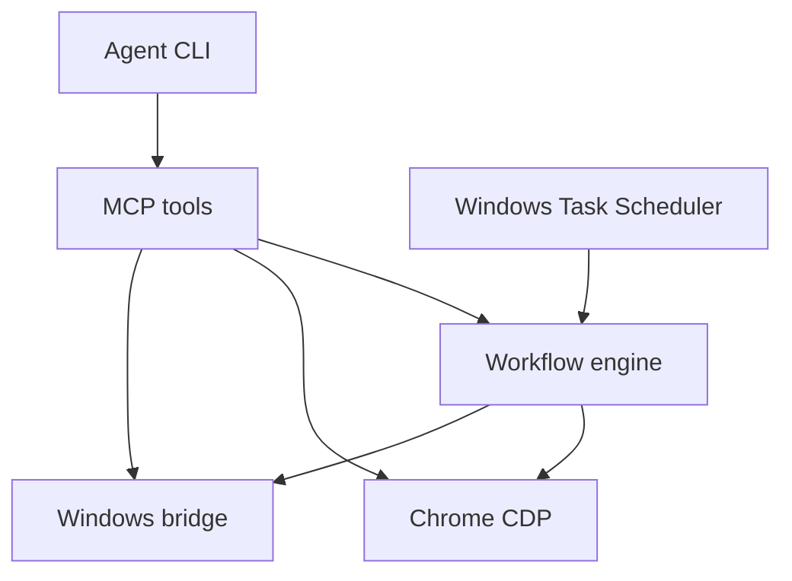

# Architecture and client configuration



The MCP server runs over the client's subprocess standard streams. It hosts a browser connection, an on-demand Windows bridge and managed CLI subprocesses. Scheduled jobs launch the same workflow engine as a separate process. A per-data-directory lock coordinates device writes between instances. The default data directory is per-user. Running multiple instances against the same desktop with different data directories bypasses that coordination.

The browser client uses a loopback debugging endpoint. Prefer a dedicated Chrome profile created by `browser_launch`. Connect to an existing endpoint explicitly with `browser_connect`. Chrome may enforce managed policies around debugging and profiles. The Windows bridge uses UI Automation and native input. The original visible recorder and its encrypted session format are preserved.

## Client setup

Generate absolute-path configuration fragments on the computer that will execute the tools:

```powershell
python main.py integrations
```

| Client | Add the generated server entry |
|---|---|
| Claude Code | Run `Connect-Claude.cmd` or use the `claude.mcp.json` fragment with `--mcp-config`. |
| Codex | Add the `codex.config.fragment.toml` block to the client's config. |
| Cline | Merge the `mcpServers` entry in `cline.mcp.json` into `~/.cline/data/settings/cline_mcp_settings.json`, or the path selected by `CLINE_MCP_SETTINGS_PATH`. |
| Antigravity | Merge the `mcpServers` entry into `~/.gemini/config/mcp_config.json` or the workspace's `.agents/mcp_config.json`. |

Restart the client or reload its MCP servers. Confirm `system_status` appears before attempting desktop control. Custom clients can use the same stdio command from the JSON fragments. Installed CLI versions and permissions determine their actual compatibility.

## Managed CLI profiles

Put user-defined profiles in `agents.json` in the data directory. The executable is resolved as a literal path or from `PATH`. Arguments are passed as an array and `{prompt}` is replaced as one argument. Use headless or print-mode flags for the particular CLI. The program reads stdout and stderr as UTF-8. JSONL events are normalized into visible messages and event summaries. Text output is also accepted.

```json
{
  "custom-agent": {
    "command": "C:\\Tools\\custom-agent.exe",
    "args": ["--headless", "{prompt}"],
    "format": "text"
  }
}
```

Keep the owning MCP client connected while using managed sessions or background workflows. A new MCP process cannot poll another process's memory. Saved conversation files remain available for explicit reading.

## Workflows and schedules

A workflow has `version`, `name`, `steps`, and optionally `required_inputs` and `browser_endpoint`. A step names an exposed action and supplies `args`. `save_as` binds results such as a newly created tab. `${name.field}` resolves a result or input, and `${env:NAME}` reads a variable from the execution environment. `if`, `foreach`, `wait`, `assert`, and `manual` are engine operations. `manual` stops unattended execution.

Schedule previews expose exact arguments, local time and the workflow digest. Scheduling uses the current Windows account and records the digest. Concurrent jobs sharing one data directory contend on a lock. Task registration and application/credential availability on the target desktop determine whether the scheduled job can run.
