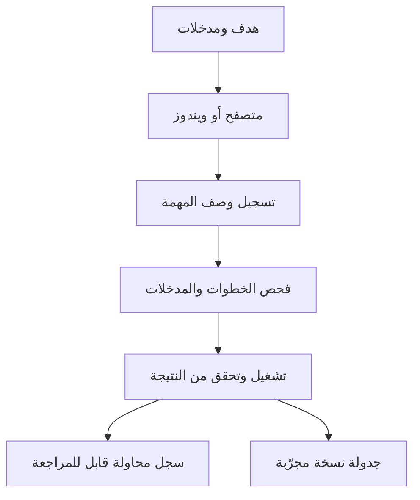

# خريطة مشروع بصمة شغل

ابدأ من هنا لاختيار القدرة، معرفة مكان تنفيذها، والوصول لطريقة تشغيلها ودليل اختبارها. تُحدّث تفاصيل أسماء الأدوات ومدخلاتها من الكود تلقائيًا في [فهرس الأدوات](reference/TOOLS.md).

## أوصل لإيه منين؟

| المطلوب | تبدأ بإيه | مكان التنفيذ | الإثبات المتاح |
|---|---|---|---|
| تركيب وتشغيل | [دليل التشغيل](USAGE_AR.md) | [ملف الإعداد](../Setup.cmd)، [فحص البيئة](../scripts/Setup.ps1)، [نقطة الدخول](../main.py) | فحص وبناء سابق لملفات ويندوز، وتحقق محلي من واجهة الأوامر |
| ربط الوكيل والتحكم منه | [تعليمات الوكيل](AGENT_HANDOFF.md) و[إعدادات الربط](ARCHITECTURE.md#client-setup) | [واجهة الأوامر](../full_automation/cli.py)، [بروتوكول الأدوات](../full_automation/mcp.py)، [ربط كلود](../scripts/Connect-Claude.ps1) | اتصال البروتوكول محليًا. الحسابات والبرامج الفعلية تحتاج تجربة على جهازك |
| كروم، الإطارات، النماذج، الملفات | [خطوات تشغيل المتصفح](../.claude/skills/operate-browser/SKILL.md) | [محرك كروم](../full_automation/cdp.py)، [فهرس أدوات كروم](reference/TOOLS.md#chrome-and-cdp) | متصفح حقيقي بصفحة محلية، تعبئة عربية وضغط وإعادة تنفيذ |
| ويندوز والنوافذ والكتابة والتصوير | [خطوات تشغيل ويندوز](../.claude/skills/operate-windows/SKILL.md) | [موصل بايثون](../full_automation/desktop.py)، [جسر ويندوز](../desktop/bridge/WindowsBridge.cs)، [ملف الجسر التنفيذي](../bin/WindowsBridge.exe) | الجسر مبني. التحكم المباشر يحتاج الاختبار على ويندوز |
| مراقبة شغلك في كروم وتحويله لمهمة | [خطوات تشغيل المتصفح](../.claude/skills/operate-browser/SKILL.md)، [تعليمات الوكيل](AGENT_HANDOFF.md) | [مسجل عرض كروم](../full_automation/demo.py) | متصفح حقيقي: تسجيل كتابة وكلمة مرور واختيار وضغط داخل Shadow DOM وتنقل، ثم إعادة بمدخلات مختلفة |
| تسجيل عرض بشري واستيراده | [دليل المسجل](../desktop/WorkObserver/README_AR.md) | [فتح المسجل](../Start-Recorder.cmd)، [المسجل](../desktop/WorkObserver/Observer.cs)، [صيغة الجلسة والتحقق](../desktop/WorkObserver/Core.cs) | بناء سابق. التسجيل وإعادته يحتاجان جلسة ويندوز تفاعلية |
| قراءة جلسات الوكلاء وشات فتحته بنفسك | [مهارة إدارة الجلسة](../.claude/skills/manage-cli-session/SKILL.md)، [مجلدات المحادثات](ARCHITECTURE.md#reading-conversations-of-clis-you-opened) | [تشغيل الوكلاء وقراءة السجلات](../full_automation/agents.py)، [ربط كودكس](../scripts/Connect-Codex.ps1) | عملية محلية فعلية، وسجل كلود كود حقيقي، وملفات تجريبية لكودكس وكلاين |
| تسجيل المهمة وفحصها وتصديرها | [صيغة المهمة](reference/WORKFLOW_FORMAT.md)، [مثال المتصفح](../examples/browser-form.json) | [محرك المهام](../full_automation/workflows.py)، [التحقق من المدخلات](../full_automation/validation.py) | تسجيل وإعادة من تشغيل مستقل، وفحص قبل التنفيذ |
| تشغيل وإلغاء ومعرفة سبب التعطّل | [دليل الاسترجاع](operations/RUNBOOK_AR.md) | [سجل المحاولات](../full_automation/history.py)، [قفل التشغيل والإيقاف](../full_automation/common.py)، [توجيه الأدوات](../full_automation/engine.py) | تحقق محلي من سجل دائم وإلغاء مهمة في الخلفية |
| المواعيد | [جزء الجدولة](operations/RUNBOOK_AR.md#الجدولة) | [تحضير التسجيل](../full_automation/scheduler.py)، [مجدول ويندوز](../scripts/Task-Scheduler.ps1) | فحص التعريف والبصمة والمدخلات. تسجيل المهمة وتشغيلها الفعلي يحتاج ويندوز |
| التأكد من ملف ناتج جديد | [فهرس أدلة المخرجات](reference/TOOLS.md#output-evidence) | [فحص الملف والبصمة](../full_automation/files.py)، [انتظار الاستقرار](../full_automation/engine.py) | اختبار يرفض ملفًا قديمًا ويثبت تغيّر بصمة الناتج |
| تعديل المشروع ومراجعة الجودة | [نظام التوثيق](README.md) و[قواعد المشروع](../AGENTS.md) | [اختبارات المنطق](../tests/test_core.py)، [اختبارات كروم](../tests/test_browser.py)، [فحص ويندوز](../tests/Windows-Smoke.ps1)، [فحص التوثيق](../scripts/docs_check.py) | كل مسار له دليل تحقق مستقل |

## مسار العمل



## أين الملفات؟

| المسار | محتواه |
|---|---|
| [جذر المشروع](../README.md) | البدء، أوامر الإعداد والربط وفتح المسجل، قواعد الوكلاء، تعريف الإصدار، وسجل التغييرات |
| [محرك بايثون](../full_automation) | فحص البيئة، توجيه الأدوات، المتصفح، ويندوز، الوكلاء، المهام، الجدولة، التحقق، وسجل التشغيل |
| [سطح المكتب](../desktop) | مصدر جسر ويندوز، مصدر المسجل التنفيذي، دليله وملفات فحصه وبصماته |
| [الملفات التنفيذية](../bin) | جسر ويندوز المبني |
| [أوامر البناء والتشغيل](../scripts) | بناء جسر ويندوز والمسجل، ربط كلود، تشغيل المجدول، وتوليد التوثيق |
| [الأمثلة](../examples) | صفحة محلية، ملف وصف المهمة، ومدخلات نموذجية |
| [الاختبارات](../tests) | اختبارات المحرك والمتصفح وفحص نوافذ ويندوز |
| [مهارات كلود](../.claude/skills) | المصدر المعتمد لإجراءات الوكيل داخل المشروع |
| [مهارات كودكس](../.agents/skills) | نسخة مولّدة من نفس الإجراءات |
| [التوثيق](README.md) | الخريطة، دليل الاستخدام، المرجع، التشغيل والاسترجاع، التاريخ، القرارات، الدروس، وخطة العمل |
| [سجل الإصدار](../CHANGELOG.md) | ما تغير للمستخدم بين الإصدارات |

## بيانات التشغيل خارج المشروع

المجلد الافتراضي على ويندوز هو الآتي. قيمة البيئة أو الخيار المبين في دليل البنية يمكنهما تغيير المسار.

```text
%LOCALAPPDATA%\FullAutomation
```

| المكان النسبي | الاستخدام |
|---|---|
| `workflows/` | ملفات المهام المحفوظة |
| `scripts/` | الكود الناتج من تصدير المهام |
| `schedules/` | تعريفات الجدولة ونسخ مدخلاتها |
| `integrations/` | إعدادات الربط المولّدة للوكلاء |
| `agents.json` و`agents/` | تهيئة أوامر الوكلاء وسجلات جلساتهم المدارة |
| `logs/actions.jsonl` | سجل الأدوات وحالاتها |
| `runs.sqlite3` | معرّفات التشغيل والتوقيت وحالة كل خطوة وعدد محاولاتها |
| `chrome-profile/` | ملف كروم المخصص الذي ينشئه التشغيل |
| `device.lock` و`STOP` | تنسيق تشغيل المهام وإشارة الإيقاف العام |

ملفات عروض المسجل المشفرة لها مكان منفصل يحدده [دليل المسجل](../desktop/WorkObserver/README_AR.md). راجع [القدرات المثبتة وحدودها](CAPABILITIES.md)، ثم [الفجوات المتبقية](ROADMAP_AR.md) قبل الاعتماد على مهمة حقيقية.
